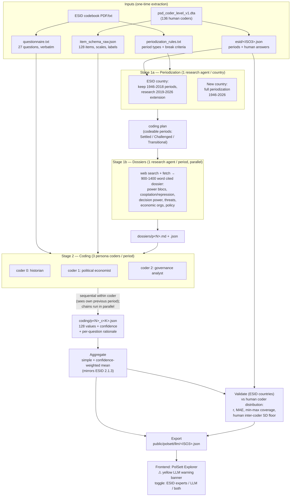

# PolSett LLM pipeline — process diagram

A multi-agent pipeline that simulates the ESID Political Settlements expert
survey. Research and coding are separated: research agents build cited
evidence dossiers; coder agents answer the survey from those dossiers only.
Every unit of work checkpoints to its own file, so any interruption resumes
by re-scanning the disk.

## Agent roles

| Agent | Count | Tools | Output |
|---|---|---|---|
| Periodizer | 1 per country | web search/fetch | period list with types + break rationales |
| Dossier researcher | 1 per period (~10–30/country) | web search/fetch, Write | cited Markdown dossier |
| Coder | 3 per period | Read (instrument + dossier), Write | 128 answers + confidence + rationales (schema-validated) |
| Aggregation / validation / export | 0 (plain Python) | — | period means, validation stats, frontend JSON |

## Design choices worth noting

- **Research/coding separation.** Coders cannot search the web; they must cite
  the shared dossier. This keeps the evidence base auditable and prevents a
  coder from rationalizing a prior with fresh searches.
- **Sequential chains, parallel coders.** Within a coder, periods are coded in
  chronological order with the previous period's answers as baseline
  (mirroring how a human expert fills the survey; scores change only when the
  dossier evidences change). Independence lives across the three personas.
- **Human-comparable validation.** For the 44 ESID countries the same
  pipeline runs on the human-coded periods, so LLM coders can be benchmarked
  against the *distribution* of human coders (is the LLM within the human
  min–max band? is its error inside human inter-coder disagreement?) rather
  than against a single "truth".
- **Checkpoint-everything.** One file per unit of work; job generators skip
  existing files. Interruptions (usage limits, laptop moves) cost only the
  in-flight units.
